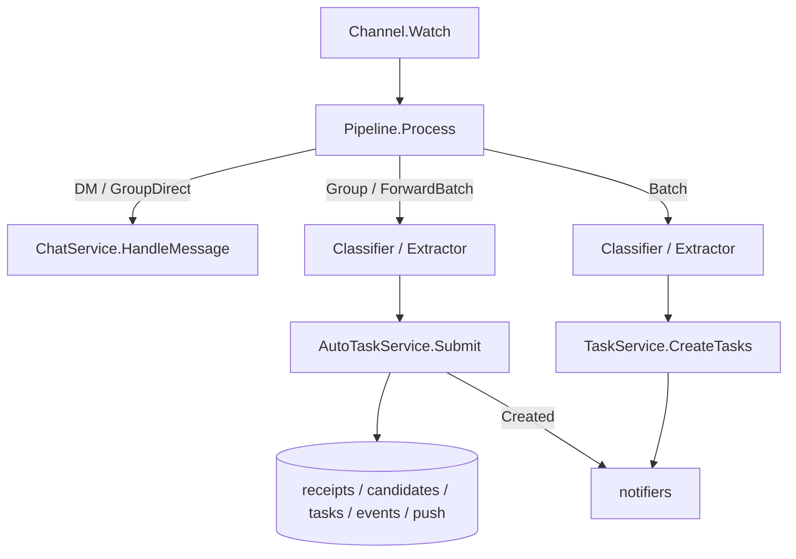

# Huskwoot — project patterns

## General

- All comments MUST be in English.
- Project documentation, commit and release messages, and project communication MUST be in English. Language-specific i18n locale resources and paired prompts MUST remain in their declared target languages.
- All code MUST be formatted with `gofmt`.
- All code MUST be idiomatic Go.

## Stack

- Go 1.26, module `github.com/anadale/huskwoot`
- Dependencies: `BurntSushi/toml`, `sashabaranov/go-openai`, `go-telegram-bot-api/v5`, `emersion/go-imap`, `spf13/cobra`, `adrg/xdg`, `pressly/goose/v3`, `modernc.org/sqlite`, `golang.org/x/time`, `nicksnyder/go-i18n/v2`
- Logging: `log/slog`

## Directory structure

```
cmd/huskwoot/main.go          — entry point, Cobra CLI, component initialization
cmd/huskwoot-push-relay/      — entry point for the huskwoot-push-relay binary
internal/model/               — shared types and interfaces (no business logic)
internal/config/              — TOML config loading
internal/ai/                  — AI client, classifier, extractor
internal/storage/             — SQLite stores (huskwoot.db in configDir)
internal/storage/migrations/  — SQL and Go migrations via goose; embedded in migrations.go
internal/pipeline/            — orchestration (Pipeline.Process)
internal/agent/               — agent: tool-calling loop, tools
internal/sink/                — TelegramNotifier, ReactionNotifier, TelegramSummaryDeliverer
internal/channel/             — TelegramChannel, IMAPChannel
internal/usecase/             — use-case layer (TaskService, AutoTaskService, ProjectService, ChatService, PairingService)
internal/dateparse/           — date and deadline parsing
internal/i18n/                — i18n bundle, localizer, locale JSON files (ru/en)
internal/reminder/            — Scheduler for periodic digests
internal/api/                 — HTTP API (chi router, /v1/*)
internal/devices/             — SQLiteDeviceStore
internal/events/              — EventStore + Broker (SSE fan-out) + retention runner
internal/push/                — PushQueue, Dispatcher, Templates, RelayClient
internal/pushproto/           — shared DTOs and HMAC helpers (instance ↔ relay)
internal/relay/               — push relay: Store, HMACMiddleware, APNs/FCM adapters, Server
internal/pairing/             — SQLitePairingStore, Broadcaster, TelegramSender
internal/transcribe/          — Transcriber implementations (WhisperCPP subprocess, Yandex SpeechKit) + async Worker
api/openapi.yaml              — OpenAPI 3.1, source of truth for the REST API
```

## Code conventions

- **Interfaces**: all key components are defined via interfaces in `internal/model/interfaces.go`. Concrete types appear only in constructors.
- **Mocks**: written by hand in the test file; no testify/mock.
- **Constructors**: `(*Type, error)` when initialization is fallible, otherwise `*Type`.
- **Context**: all public methods accept `context.Context` as the first parameter.
- **Errors**: `fmt.Errorf("operation description: %w", err)`.
- **Concurrency**: `sync.Mutex`/`sync.RWMutex`; parallel notifiers use `sync.WaitGroup`.
- **Artifacts**: `go build` output always goes to `bin/`.
- **i18n**: components with user-facing text accept `*i18n.Localizer` via constructor (sink, agent tools). Strings are stored in `internal/i18n/locales/ru.json` and `en.json`. Prompts are paired templates `*_ru.tmpl` / `*_en.tmpl`; `loadPrompt(fsys, lang, name)` falls back to `_ru` if the language file is not found.

## Pipeline architecture

### Message processing flow



DM voice/audio messages bypass the pipeline inline path: `TelegramChannel` enqueues them to `voice_queue` immediately (cursor saved, no transcription in the polling goroutine). `transcribe.Worker` claims jobs asynchronously, dispatches download via `VoiceDownloader` and transcription via `Transcriber`, then passes the result to the appropriate `VoiceConsumer`. For Telegram jobs, `telegramVoiceConsumer` (in `internal/channel/telegram_voice_consumer.go`) calls `BuildVoiceMessage` and `Pipeline.Process(MessageKindDM)`; for client jobs, `clientVoiceConsumer` (in `internal/usecase/`) emits `chat_message_created` SSE events and calls `ChatService.HandleMessage`.

Configuration commands (e.g. binding a group chat to a project) are handled through the agent: mention the bot or reply to it (`MessageKindGroupDirect`) and the agent's `set_project` tool performs the binding.

### MessageKind

- `MessageKindDM` — direct message from the owner in Telegram
- `MessageKindBatch` — email from IMAP
- `MessageKindGroup` — regular message in a Telegram group chat
- `MessageKindGroupDirect` — mention (`@bot`) or reply to the bot; detected via `TelegramChannelConfig.BotID`
- `MessageKindForwardBatch` — accumulated forwarded messages from a 1:1 Telegram chat, dispatched by timeout or user trigger

Reactions (`msg.ReactFn`): ✍️ after Promise classification, 👍 after successful processing. `nil` when `reaction_enabled: false`.

`HistoryFn` is set for Group/GroupDirect/DM (when `history != nil`); `nil` for IMAP. Pipeline calls it in `processPromise`.

**History hygiene:** forwarded messages and the user-trigger message are **not written** to `SQLiteHistory`. Only the bot's reply after extraction is recorded via the standard `recordBotReply` path.

### Transactional pattern (use-case layer)

The use-case layer owns `*sql.DB` and transactions. Write-method pattern:

1. `tx, err := db.BeginTx(ctx, nil)`
2. Tx-aware calls: `CreateTaskTx`, `MetaStore.SetTx`, `EventStore.Insert`, `PushQueue.Enqueue` — all within a single transaction.
3. `tx.Commit()` → `Broker.Notify(event)` (in-memory SSE fan-out).

Atomicity of "entity + event + push_queue" is guaranteed by a single transaction. `Broker` does not write to the DB.

### Automatic task deduplication

`AutoTaskService` applies only to automatic extraction from Telegram Group/ForwardBatch. Explicit agent commands, the REST API, and IMAP retain their existing behavior. Shared types live in `internal/model/auto_tasks.go`, interfaces in `internal/model/interfaces.go`, and the implementation in `internal/usecase/auto_tasks.go`.

The smart model compares a candidate against all open tasks in the project, tasks closed within the last 14 days, and pending/rejected candidates. Candidates from the same extraction are also considered. `Task.Confidence` is not used as a duplicate score. When the reference set is empty, the task is created without an additional AI request.

A `same` result with a score at or above `tasks.duplicate_threshold` (default 0.95), no conflict, and an open/pending/rejected reference is skipped. A `different` result below `tasks.review_threshold` (0.70) with no conflict is created. All other results, including comparison errors, are saved as pending. A match against a closed task does not permit automatic skipping.

The owner receives a DM question with inline 👍/👎 buttons, not actual reactions. `SetTaskCandidates` is called before `Watch` starts; `RunTaskQuestions` delivers unsent questions. Callbacks are handled before guard/history/forward/agent processing and validate the owner, private chat, and bot-authored message. `Decide` atomically records the first decision; repeated callbacks do not create another task.

Receipts, decisions, tasks, events, push jobs, and buffer `Finalize` are atomic. AI calls run outside the transaction; the event revision is rechecked before writing. The receipt key includes account/chat/message and a text hash. Group messages complete synchronous intake before the update is acknowledged; DM/GroupDirect and IMAP remain queued.

### Task source details and priority

Every task stores a snapshot of where it came from in `tasks.source_details` (JSON of `model.TaskSourceDetails`, migration `016_task_priority_source.sql`). It is taken at creation time and never points at `messages`: channel history is trimmed by TTL and `MaxMessages`, so a reference would rot. Fields: `Name` (chat title or mailbox), `Subject` (IMAP), `Author`, `Text`, `At`, `ReplyTo{Author, Text}`, `Link`, `Via`. `Capped()` truncates `Text` to 1000 runes and `ReplyTo.Text` to 500; `CreateTaskTx` stores the capped copy. An empty or malformed column reads as `nil` details without failing the read. `source_kind`/`source_id` keep their meaning.

| Creation path | `Source` | `Via` | Details |
|---|---|---|---|
| Pipeline message (Telegram group, IMAP) | from the message | `message` | `model.SourceDetailsFromMessage(msg, via)` |
| Forward batch | the 1:1 chat | `forward` | the forwarded entry named by `Task.ForwardIndex` (see the forward batch flow) |
| Agent `create_task` | origin message `Source` | `chat`, or `voice` when the origin has `VoiceJobID` | `SourceDetailsFromMessage(origin, via)` |
| REST `POST /v1/tasks` | `{Kind: "client", ID: device id}` | `api` | none |

`SourceDetailsFromMessage` leaves `Name` and `Author` empty for client sources (the client knows its own device names) and falls back to the author id when the display name is empty. `model.TelegramMessageLink` builds `https://t.me/c/<id>/<message id>` only for supergroups and channels (chat id `-100<id>`); private chats, basic groups, forwards and IMAP get no link. New task creation paths MUST set both `Source` and `SourceDetails` on `CreateTaskRequest`.

`Task.Priority` (`model.TaskPriority`: 0 none, 1 low, 2 medium, 3 high; column `tasks.priority`) is set on create and update. `TaskService.CreateTasks` and `UpdateTask` reject values outside 0–3 with `usecase.ErrInvalidTaskPriority` (the REST API maps it to 422). `createAutoTaskTx` copies `Priority` and `SourceDetails` from the request, so candidates keep both in their payload until approval. The extractors return priority 3 only for explicitly stated urgency and turn missing, malformed or out-of-range values into 0. Agent tools parse the argument with `parsePriorityArg` (integer or numeric string 0–3; missing or `null` = not set) and add `priority`/`priority_marker` (`!`…`!!!`) to their output through `addPriority`, only for priority > 0.

### Forward batch flow (Telegram 1:1 promises)

Allows the owner to forward arbitrary messages from a private 1:1 Telegram chat into DM with the bot. The bot accumulates them in SQLite, then on timeout or user trigger extracts promises the owner made and creates tasks.

```
TelegramChannel.handleDirectMessage(m)
  ├─ forward from user → ForwardBuffer.Append(entry)
  │    IsSelfAuthored = (ForwardFrom.ID == cfg.User.TelegramUserID)
  │    NOT written to SQLiteHistory; NOT sent to pipeline
  │
  ├─ voice/audio DM → VoiceEnqueueFn(VoiceJob) → voice_queue (async)
  │    pre-flight: MaxDuration check, Transcriber nil check (sync replies on failure)
  │    cursor saved; transcribe.Worker picks up later → Pipeline.Process(DM)
  │
  ├─ regular DM + buffer non-empty → ForwardDispatcher.Submit(signal)
  │    trigger message NOT written to SQLiteHistory; NOT sent to ChatService
  │
  └─ regular DM + buffer empty → ChatService.HandleMessage (unchanged)

ForwardBatchSweeper (ticker, default 5s interval)
  → ListPendingChats(now - timeout) → ForwardDispatcher.Submit per chat_id

ForwardDispatcher (single-goroutine consumer)
  → LoadBatch → Pipeline.Process(MessageKindForwardBatch)
```

Pipeline `processForwardBatch`:
1. Parse `triggerText` via `parseTriggerProjectHint` → resolve project or fallback Inbox.
2. Exclude forwards with saved input receipts, then format the remaining snapshot via `FormatForwardBatch` → a labeled block identifying the owner or the sender by name. Every line is numbered in sorted order (`[N] [author, date] text`), and the sorted entries are returned alongside the text: entry `i` is message number `i+1`.
3. `ForwardClassifier.Classify` → `promise` | `skip`.
   - `skip`: `AutoTaskService.Submit` with no tasks persists receipts and clears only the snapshot via `DeleteEntriesTx`; reply "no promises found"; Telegram forwards are NOT deleted.
4. `ForwardExtractor.Extract` → `[]model.Task`. The model returns `"message": <N>` for every task; it lands in the in-memory `Task.ForwardIndex` (0 when missing or malformed).
5. `AutoTaskService.Submit` compares candidates; one transaction saves decisions, tasks/events/push for new obligations, input receipts, and deletes only snapshot entries via `Finalize` + `DeleteEntriesTx`. Commit. Source details (`forwardSourceDetails`): `Name` is the counterpart; a valid `ForwardIndex` adds the entry's `ForwardFromName`, text and original date; a missing or out-of-range index keeps only the latest original date of the batch.
6. `Broker.Notify(events)` after commit.
7. If `DeleteForwardsAfterExtract && len(result.Created) > 0`: call `payload.DeleteFn`; errors → `slog.Warn` only.
8. Reply with created tasks and counts of pending candidates and skipped duplicates.

Transactional invariant: "decisions + tasks + snapshot buffer clear" are atomic. New forwards arriving during inference remain buffered. On crash between commit and Telegram delete, results are saved and forwards may remain in DM. Sweeper handles restart recovery.

### TelegramChannel.Watch internals

**Cursor contract (at-least-once):** The update cursor is saved once per batch after the full batch is processed. If `processRawUpdate` returns `false` for update N, the cursor advances only to update N−1. This ensures at-least-once delivery: on crash mid-batch, updates from that batch are redelivered on restart. Pipeline idempotency absorbs duplicates.

For Group messages, `watchHandler` waits for `Pipeline.Process` before acknowledging the input. A Group handler error or callback persistence error returns `false`; retries use a context-aware delay. Group intake MUST NOT be replaced with a simple enqueue to `msgCh`: persistence errors would then occur after the cursor has advanced.

**Backoff on getUpdates errors:** Starts at 1 second, doubles on each consecutive error up to 30 seconds max (`1s → 2s → 4s … 30s`). If the Telegram API returns `RetryAfter`, that duration is used directly. Resets to 1 second on the first successful response.

**ForwardSignal delivery:** `handlePrivateDMForBuffer` blocks for up to `ForwardSignalTimeout` (default 5 seconds) when sending to `ForwardDispatcher`. On timeout, logs `slog.Error` and returns `false`, which prevents the cursor from advancing past that update — the trigger is redelivered on restart.

### Classifiers

- `SimpleClassifier` (Batch) — `promise` or `skip`
- `GroupClassifier` (Group) — `promise` or `skip`
- `ForwardClassifier` (ForwardBatch) — `promise` or `skip`; focuses on promises made by the owner (lines labeled as the owner, each prefixed with its `[N]` number)

### MetaStore and project binding

Key `"project:"+channelID` → `projectID`. `ProjectService.ResolveProjectForChannel(channelID)` — lookup in MetaStore, fallback to `DefaultProjectID()` (Inbox).

## SQLite stores

All backed by a single `huskwoot.db`. `storage.OpenDB` enables WAL, foreign keys, and applies goose migrations.

Stores:
- `SQLiteStateStore` — read cursors. Table `cursors`.
- `SQLiteMetaStore` — channel metadata. Table `channel_projects`. Single write method: `SetTx(ctx, tx, key, value)`.
- `SQLiteTaskStore` — projects and tasks. Automatically inserts Inbox on creation (INSERT OR IGNORE). Write methods are tx-aware; for reads inside a transaction: `GetProjectTx`, `GetTaskTx`. Project aliases are stored in `project_aliases` table (1:N with `ON DELETE CASCADE`); new tx-aware methods: `AddProjectAliasTx`, `RemoveProjectAliasTx`, `ListAliasesForProject`. `ListClosedOlderThan(ctx, cutoff)` returns full snapshots of `done`/`cancelled` tasks whose `closed_at < cutoff`; `DeleteTaskTx(ctx, tx, id)` physically removes a task by id within the caller's transaction. Both are used by `TaskService.PurgeClosedOlderThan` so it can emit `task_deleted` events transactionally with the delete; the `idx_tasks_status_closed_at` index speeds up the list query. Columns `priority` and `source_details` (migration `016_task_priority_source.sql`) are written and read on every task path; see "Task source details and priority".
- `CachedTaskStore` — decorator that caches `ListProjects` in memory (invalidated via `projectService.invalidateProjectCache()` after any commit that changes the project set: `CreateProject`, `UpdateProject` when fields actually change, `AddProjectAlias`, `RemoveProjectAlias`). In `main.go`, `*SQLiteTaskStore` is always wrapped in `CachedTaskStore`.
- `SQLiteHistory` — message history. Table `messages`. Column `message_id TEXT` (UUID v4, generated by the application on insert) with a UNIQUE index; added by migration `013_messages_message_id.sql`. `AddTx(ctx, tx, source, entry) (messageID string, err error)` inserts within a caller-supplied transaction and returns the UUID; `Add` wraps it in its own transaction. Client chat metadata (migration `017_chat_message_metadata.sql`): `role` (`user` | `agent` | `system`; `''` for channel rows; existing `client:%` rows were backfilled from `author_name`), `kind` (`text` | `voice` | `error`, default `text`), `audio_job_id`, `audio_duration_ms`, `task_ids` (JSON array of task UUIDs). Only the client chat and voice paths fill them. For `client:` sources `AddTx` also deletes the oldest rows beyond `storage.ClientHistoryCap` (1000) in the same transaction. `SetTaskIDs(ctx, messageID, ids)` merges ids into a row without duplicates (unknown message → error wrapping `sql.ErrNoRows`). `Recent` and `RecentActivity` skip `role = 'system'` rows, so voice failures never reach the agent prompt. `ListClient(ctx, source, before, limit)` returns one page for `GET /v1/chat/history`: the newest `limit` rows older than the `before` message (system rows included), oldest first, plus the next cursor; an unknown `before` wraps `model.ErrHistoryCursorNotFound`.
- `devices.SQLiteDeviceStore` — devices and bearer tokens. `Get` returns revoked devices too; `nil, nil` if not found. `ListInactive` returns active devices whose `COALESCE(last_seen_at, created_at)` is older than cutoff; `DeleteRevokedOlderThan` physically removes rows whose `revoked_at` is older than cutoff.
- `events.SQLiteEventStore` — domain events. Table `events`, monotonic `seq` AUTOINCREMENT.
- `push.SQLitePushQueue` — push job queue. Table `push_queue`. `ON DELETE CASCADE` on `event_seq` (retention deletes pending jobs together with events).
- `storage.SQLiteForwardBuffer` — accumulates forwarded Telegram messages pending extraction. Table `forward_buffer` with `UNIQUE(chat_id, message_id)` for idempotency while buffered. Methods: `Append` (INSERT OR IGNORE), `LastReceivedAt`, `LoadBatch` (ordered by `original_date ASC`), `DeleteEntriesTx(ctx, tx, chatID, messageIDs)` (deletes only the processed snapshot), `ListPendingChats(before time.Time)`.
- `storage.SQLiteAutoTaskStore` — tables `auto_task_inputs` and `auto_task_candidates` (migration `015_auto_tasks.sql`); durable receipts and candidate states `pending`/`created`/`rejected`/`duplicate`, including pending question delivery and terminal decision replay.
- `storage.SQLiteVoiceQueue` — pending voice transcription jobs. Table `voice_queue` (recreated by migration `012_voice_queue_sources.sql`). Fields: `source_kind` (`'telegram'` | `'client'`), `payload` (Telegram `file_id` or client relative path `<uuid>.<ext>`), `mime_type`, `duration_ms`, `device_id` (client-only), `client_job_id` (UUID v4, client-only), `project_id` (optional project hint UUID, client-only), `chat_id`/`message_id` (Telegram-only, nullable). Indexes: `idx_voice_queue_pending` on `next_attempt_at`; partial UNIQUE `idx_voice_queue_telegram_uniq` on `(chat_id, message_id) WHERE source_kind='telegram'`; partial UNIQUE `idx_voice_queue_client_job_id` on `client_job_id WHERE client_job_id IS NOT NULL`. Methods: `Enqueue` (INSERT OR IGNORE), `Claim(now)` (next job whose `next_attempt_at <= now`, nil if empty), `Complete` (DELETE on success), `Reschedule(nextAt, lastErr)` (UPDATE attempts++ on failure), `HasClientPayload(ctx, payload) (bool, error)` (used by orphan sweep; filters by `source_kind='client'`). `transcribe.Worker` applies backoff 30s → 2m → 10m and drops after 4th attempt.

Human-readable task reference: `<slug>#<number>` (method `Task.DisplayID()`).

## Agent

Handles `MessageKindDM` and `MessageKindGroupDirect` via a tool-calling loop (maximum 5 iterations).

### Agent config

- `Config.Now func() time.Time` — current time injected into the system prompt and into `create_task` via `context.Value(nowKey)`. Falls back to `time.Now()` when `nil`.
- `Config.ListProjects func(ctx) ([]Project, error)` — project list injected into the system prompt ("Known projects" block). Block is omitted when `nil`.

### Origin message

`Agent.Handle` stores the incoming `model.Message` in the tool context via `WithOriginMessage(ctx, msg)`; tools read it with `OriginMessageFromContext(ctx)`. `create_task` uses it to attribute the task: `Source` = origin `Source`, `Via` = `voice` when `VoiceJobID` is set (client voice consumer), otherwise `chat`, plus the user's text or transcript and time. Tools that create tasks MUST take the source from the origin message instead of leaving it empty.

### Tools

| Tool | DMOnly | Description |
|---|---|---|
| `create_project` | yes | Create a project (optional `aliases` parameter: list of short trigger words) |
| `list_projects` | yes | List all projects |
| `get_project` | yes | Get full project details by UUID, slug, or alias |
| `update_project` | yes | Update project name, description, or slug (ref = UUID \| slug \| alias) |
| `add_project_alias` | yes | Add an alias to a project (ref = UUID \| slug \| alias) |
| `remove_project_alias` | yes | Remove an alias from a project |
| `create_task` | no | Create a task (no project_id → Inbox; optional `priority` 0–3) |
| `list_tasks` | no | Tasks in a project filtered by status |
| `complete_task` | no | Mark a task as completed |
| `move_task` | no | Move a task (UUID or `<slug>#<number>`) |
| `set_project` | no | Bind the current chat to a project |
| `get_task` | no | Get full task details by UUID or `<slug>#<number>` |
| `update_task` | no | Update summary, details, deadline, or priority (0–3) of a task |
| `cancel_task` | no | Cancel (soft-delete) a task; reversible via `reopen_task` |
| `reopen_task` | no | Reopen a completed or cancelled task |
| `snooze_task` | no | Postpone a task by setting a new deadline (natural language) |
| `search_tasks` | no | Search tasks by query, status, project, or date range |

`MessageKindGroupDirect`: tools where `DMOnly() == true` are excluded.

### Task resolution

All tools that accept a task identifier use the shared helper `resolveTask` in `internal/agent/resolve_task.go`. It accepts a UUID or `<slug>#<number>` reference (e.g. `inbox#3`) and returns `*model.Task` or an i18n error. `parseTaskRef` also lives there. New tools must call `resolveTask` instead of inlining lookup logic.

### Project resolution

All tools that accept a project identifier use the shared helper `resolveProjectRef` in `internal/agent/resolve_project.go`. It accepts a UUID, slug, or alias and returns `*model.Project` with an i18n-wrapped error on failure. New tools must call `resolveProjectRef` instead of inlining lookup logic.

## Testing

- TDD: tests are written before the implementation
- Table-driven: `[]struct{name, input, want}`
- `go test ./...` / `go vet ./...`

## Configuration

TOML file `config.toml` in configDir. `${ENV_VAR}` placeholders are expanded on load. Priority: `--config-dir` → `$HUSKWOOT_CONFIG_DIR` → XDG (`~/.config/huskwoot`).

### `[datetime]`

```toml
[datetime]
timezone = "Europe/Moscow"
weekdays = ["mon", "tue", "wed", "thu", "fri"]
night_cutoff = "05:00"  # optional: before this time, "tomorrow"→today, "day after tomorrow"→tomorrow, "до завтра"/"до послезавтра" shifted too; "today" is always literal (not shifted); "" or "00:00" = off (default)

[datetime.time_of_day]
morning = 11; lunch = 12; afternoon = 14; evening = 20
default = "evening"  # time-of-day marker applied when a date is given without an explicit time; does not affect "до …" deadline expressions
```

### `[reminders]`

```toml
[reminders]
plans_horizon = "168h"     # 'd' suffix is not supported
undated_limit = 5
send_when_empty = "morning"  # "always" | "never" | "morning"

[reminders.schedule]
morning   = "09:00"   # required
afternoon = "14:00"   # empty string disables the slot
evening   = "20:00"
```

Digests are sent to `user.telegram_user_id`.

### `[user]` (identity fields)

```toml
[user]
user_name = "Alice"              # used in AI prompts and the GET /v1/me response
telegram_user_id = 123456789    # required when channels.telegram is present
language = "ru"                  # "ru" | "en", default "ru"
```

### `[api]`

```toml
[api]
enabled = true
listen_addr = "127.0.0.1:8080"
external_base_url = "https://huskwoot.example.com"
request_timeout = "30s"
chat_timeout = "60s"
events_retention = "168h"               # 'd' suffix is not supported
cors_allowed_origins = []
pairing_link_ttl = "5m"
pairing_status_long_poll = "60s"
rate_limit_pair_per_hour = 5
voice_max_bytes = "10MiB"              # MaxBytesReader limit for POST /v1/chat/voice; default 10 MiB
voice_rate_limit_per_minute = 10       # per-device rate limit for POST /v1/chat/voice; 0 → default 10; negative → error
```

### `[push]`

```toml
[push]
relay_url           = "https://push.huskwoot.app"
instance_id         = "nickon"
instance_secret     = "${HUSKWOOT_PUSH_SECRET}"
timeout             = "10s"
dispatcher_interval = "2s"
batch_size          = 32
retry_max_attempts  = 4
```

`PushConfig.Enabled()` → `true` when `relay_url`, `instance_id`, `instance_secret` are all non-empty. Otherwise a `nilRelayClient` is used and the dispatcher does not start.

### `[devices]`

```toml
[devices]
inactive_threshold = "720h"   # 30 days without activity → auto-revoke
retention_period   = "2160h"  # 90 days after revoke → physical delete
```

The retention runner runs every hour (`events.Runner.Tick`): it iterates `DeviceStore.ListInactive(now - inactive_threshold)` and for each entry calls `Revoke` + `RelayClient.DeleteRegistration`. Relay errors are logged but do not abort the local revoke. Separately, `DeleteRevokedOlderThan(now - retention_period)` is invoked to physically delete rows from the `devices` table. A value of `0` in either setting disables the corresponding sweep; the default operating values are 30 / 90 days.

### `[tasks]`

```toml
[tasks]
closed_retention = "336h"   # 14 days after closed_at → physical delete of done/cancelled
cleanup_time     = "04:00"  # local time-of-day in the user timezone (datetime.timezone)
```

Once per day `events.Runner` calls `TaskService.PurgeClosedOlderThan(now - closed_retention)` after `cleanup_time` (in `datetime.timezone`), removing tasks in status `done`/`cancelled` whose `closed_at < cutoff`. Open tasks and recently closed tasks are preserved. `closed_retention = "0s"` disables the cleanup. The sweep does not run on startup — it waits for the next `cleanup_time` slot; if the daemon starts after the slot, the cleanup is deferred to the next day.

For each deleted task the use-case emits a `task_deleted` event inside the same transaction as the `DELETE FROM tasks`, then notifies the in-memory `Broker` (SSE fan-out) and enqueues push jobs for inactive devices. Subscribed clients learn about the removal via `/v1/events`; clients reconnecting later replay it while it remains inside the `events_retention` window. Push templates intentionally drop `task_deleted` (no user-facing notification).

### `[channels.telegram]` (forward batch)

```toml
[channels.telegram]
forward_batch_timeout         = "10s"   # silence window before auto-processing; "" or "0s" disables the feature
delete_forwards_after_extract = false   # delete forwarded messages + trigger from DM on successful extraction
```

`ForwardBatchTimeout` is parsed via `time.ParseDuration`; empty string is equivalent to `"0s"` and disables the feature. Negative values produce a config error. When disabled, `TelegramChannel` treats forwarded messages as regular DMs (no accumulation).

### `[transcriber]`

Voice messages in Telegram **DM** (`MessageKindDM`) are enqueued to `voice_queue` and transcribed asynchronously by `transcribe.Worker`. Group and GroupDirect voice messages are not transcribed. When `provider = ""` (or the section is absent), the bot replies with `voice.disabled` i18n message synchronously (no enqueue) and does not crash. Pre-flight checks (duration limit, provider availability) run synchronously in `TelegramChannel` before enqueue — failures reply immediately without entering the queue.

```toml
[transcriber]
provider     = "whisper"   # "" | "whisper" | "yandex"; empty = disabled
max_duration = "5m"        # hard upper bound on voice duration; default 5m
uploads_dir  = ""          # directory for client voice uploads; default: <configDir>/voice_uploads; created on startup with 0o700

[transcriber.whisper]
binary   = "/usr/local/bin/whisper-cli"   # required
model    = "/var/huskwoot/models/ggml-base.bin"  # required
language = "ru"           # default: empty (auto-detect)
ffmpeg   = "ffmpeg"       # default: "ffmpeg" (resolved via PATH)
threads  = 4              # default: 0 (the -t flag is not passed)
timeout  = "60s"          # default: 60s

[transcriber.yandex]
api_key   = "${YANDEX_SPEECHKIT_API_KEY}"   # required
folder_id = "${YANDEX_FOLDER_ID}"           # required
language  = "ru-RU"       # default: "ru-RU"
endpoint  = "https://stt.api.cloud.yandex.net/speech/v1/stt:recognize"  # default
timeout   = "30s"         # default: 30s
```

Validation:
- `provider == "whisper"` → `binary` and `model` are required.
- `provider == "yandex"` → `api_key` and `folder_id` are required.
- `provider` not in `{"", "whisper", "yandex"}` → error.
- `max_duration` parsed via `time.ParseDuration`; empty → 5m; negative → error.

## HTTP API

Base path `/v1`. Source of truth is `api/openapi.yaml`. Any API change **must be made in the yaml first**.

**JSON**: request/response bodies use **camelCase**. URL query parameters use `snake_case`.

**Auth**: `Authorization: Bearer <token>`. Middleware computes `SHA256(token)` and looks it up via `DeviceStore.FindByTokenHash`. No auth required: `/healthz`, `/readyz`, `/v1/openapi.yaml`, `/v1/pair/*`, `/pair/confirm/*`.

**Idempotency**: `Idempotency-Key: <uuid>` on POST/PATCH. In-memory LRU cache `(device_id, key) → response`, TTL 1 hour.

**SSE** (`/v1/events`): `Last-Event-ID: <seq>` for replay. Heartbeat `:keepalive` every 15s. Format: `id: <seq>\nevent: <kind>\ndata: <json>\n\n`.

**Cold-sync** (`/v1/sync/snapshot`): all projects + open tasks + `last_seq`. Use on first connection or after missing the retention window.

**Retention**: runs hourly via `events.Runner.Tick`. Sequence: `PairingStore.DeleteExpired` → device sweep (`ListInactive` → `Revoke` + `RelayClient.DeleteRegistration` → `DeleteRevokedOlderThan`) → orphan voice-upload sweep (`filepath.WalkDir(uploadsDir)`: files older than 24 h with no matching row in `voice_queue` are removed) → `PushQueue.DeleteDelivered` → `EventStore.DeleteOlderThan(now - events_retention)`. Errors in one subsystem do not skip the others.

**Voice chat** (`POST /v1/chat/voice`): multipart upload (`audio` + `metadata` JSON parts). Accepted MIME types: `audio/ogg;codecs=opus`, `audio/mp4`, `audio/webm;codecs=opus`. Returns `202 {jobId, createdAt}`; result delivered via `/v1/events` as two `chat_message_created` events (`role: user` then `role: agent`). On transcription failure: `voice_failed` event with `jobId`, `code`, `message`, plus a history row (`role: system`, `kind: error`, `AuthorName: "system"`, the audio job id) in the same transaction; a history write error is logged and does not suppress the event. The transcript row is `kind: voice` with the audio job id and duration; the agent reply row is plain text with `TaskIDs`. When the agent mutates a task but replies late, the synthetic "Готово" reply stores the ids of the tasks this agent call touched — a `touchedSet` the consumer puts into the `HandleMessage` context (`withTouched` reuses it, the task service fills it) — and the late `ChatReply.TasksTouched` are merged into it through `History.SetTaskIDs` (no extra SSE event). Broker task events reach every subscriber whatever their source, so they only arm the ack timer; without touched tasks no synthetic reply is sent. Rate-limited per device (`voice_rate_limit_per_minute`, default 10). Requires `Transcriber != nil`; returns `503` otherwise. Supports `Idempotency-Key`.

**Tasks**: `Task` responses (GET, lists, `POST`/`PATCH` results, sync snapshot — all via `toTaskDTO`) always include `priority` (0–3) and include `source` (`kind` from `Source.Kind` plus the source details) unless the task has neither a kind nor details. `POST /v1/tasks` accepts an optional `priority`; `PATCH /v1/tasks/{id}` accepts `priority` (listed in `allowedTaskUpdateFields`). A non-integer, `null` or out-of-range priority returns 422 `unprocessable`; 0 clears it. REST-created tasks get `Source{Kind: "client", ID: device id}` and `via: api`.

**Chat history** (`GET /v1/chat/history?limit=&before=`): one page of the device's client chat (`client:<device id>`) via `History.ListClient`: the newest `limit` entries (default 50, capped at 500) older than the `before` message id, oldest first, with `nextBefore` for the next older page (omitted on the last page). An unknown `before` returns 400 `bad_request`. Entries carry `id`, `role` (rows without a stored role get it from `author_name`), `kind`, `text`, `createdAt`, `audio{jobId, durationMs}` when the row has an audio job id, and `tasks` — compact cards (`id`, `ref`, `summary`, `status`, `deadline`) resolved through `TaskService.GetTask` once per id at read time, deleted tasks skipped. `authorName` and `timestamp` stay for older clients.

**New SSE event kinds**:
- `chat_message_created`: `{messageId, source:{kind,id}, role, kind, text, audioJobId?, audioDurationMs?, taskIds?, createdAt}` — emitted by both `POST /v1/chat` (text) and `POST /v1/chat/voice` (voice). `messageId` equals the `id` of the matching `GET /v1/chat/history` entry.
- `voice_failed`: `{jobId, code, message}` — emitted when transcription fails after all retries.

### Pairing flow

- `POST /v1/pair/request` → sends a magic-link DM to the owner, returns `{pairId, pollUrl, expiresAt}`.
- `GET /v1/pair/status/{id}?nonce=<clientNonce>` — long-poll; on confirmation: `{status:"confirmed", deviceId, bearerToken}`.
- `GET /pair/confirm/{id}` — HTML form + CSRF cookie (`__Host-csrf` over HTTPS, `csrf` over HTTP).
- `POST /pair/confirm/{id}` — CSRF validation, device creation, `Broadcaster.Notify`.

Pairing sentinel errors: `ErrPairingNotFound`, `ErrPairingExpired`, `ErrNonceMismatch`, `ErrCSRFMismatch`, `ErrAlreadyConfirmed`, `ErrSenderFailed`.

Project sentinel errors (`internal/usecase/projects.go`): `ErrProjectNotFound` → 404; `ErrAliasInvalid` → 400; `ErrAliasTaken` → 409; `ErrAliasConflictsWithName` → 409; `ErrAliasLimitReached` → 409; `ErrAliasForbiddenForInbox` → 403; `ErrAliasNotFound` → 404.

## Push relay

### HMAC protocol

Canonical string: `METHOD + "\n" + PATH + "\n" + TIMESTAMP + "\n" + lower(hex(SHA256(body)))`.
Headers: `X-Huskwoot-Instance`, `X-Huskwoot-Timestamp` (unix seconds), `X-Huskwoot-Signature` (hex HMAC-SHA256). Window: ±5 minutes.
Details: `docs/push-relay/hmac.md`.

### Task event payload

```json
// task_created, task_completed, task_moved, task_reopened, task_deleted:
{"task": {...taskSnapshot...}}

// task_updated:
{"task": {...taskSnapshot...}, "changedFields": ["summary", "deadline"]}

// project_updated:
{"project": {...projectSnapshot...}, "changedFields": ["name"?, "description"?, "slug"?, "aliases"?]}
```

`taskSnapshot` keys are snake_case and include `priority` (always) and `source` (`kind` plus the `model.TaskSourceDetails` keys, `replyTo` included; omitted when the task has neither a kind nor details).

`changedFields` order for tasks: `summary`, `details`, `topic`, `deadline`, `status`, `priority`. `Templates.Resolve` for `task_updated` without `summary`/`deadline` → `ok=false` (dropped). `task_deleted` is also dropped by `Templates.Resolve` — it is delivered via SSE only.

`changedFields` order for projects: `name`, `description`, `slug`, `aliases`. `Templates.Resolve` for `project_updated` → always `ok=false` (dropped; no push notification sent).

### Dispatcher backoff

5s → 30s → 5m → 30m, dropped after the 4th attempt.

### Registration sync

`UpsertRegistration`: called after `ConfirmWithCSRF` (commit) and after `patchMe` (UpdatePushTokens).
`DeleteRegistration`: called after `Revoke` (API and CLI). Relay errors are logged as warnings and do not block local state.

### Binary

```sh
go build -o bin/huskwoot-push-relay ./cmd/huskwoot-push-relay/
```

Config: `cmd/huskwoot-push-relay/relay.example.toml`. Dockerfile: `Dockerfile.push-relay`.

## CLI

- `huskwoot serve` — daemon (pipeline + HTTP API + retention + reminders)
- `huskwoot devices create --name "iPhone" --platform "ios"` — token is printed once; SHA256 hash is stored in the DB
- `huskwoot devices list` — table of all devices including revoked ones
- `huskwoot devices revoke <device-id>` — no-op on repeated calls

The `--config-dir` flag is inherited by all subcommands.

## Miscellaneous

- `main.go` creates a **single** `*tgbotapi.BotAPI` for `[channels.telegram]`, shared among `TelegramChannel`, `ReactionNotifier`, `TelegramNotifier`, and `pairing.TelegramSender`.
- IMAP: each folder in `IMAPConfig.Folders` runs in its own goroutine; StateStore key is `imap:username:folder`. Outgoing messages (`from == cfg.Username`) have their body split via `splitEmailReply`.
