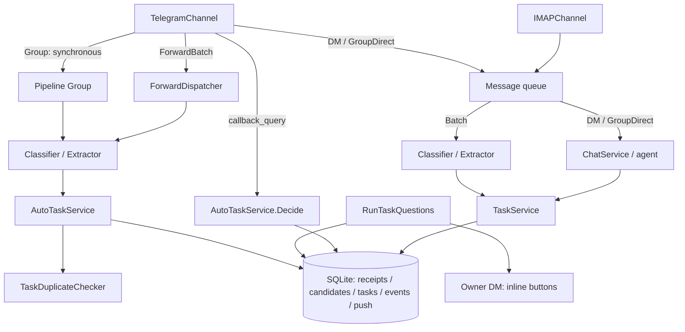

# Architecture

## Message Processing Pipeline

## Message Kinds

| Kind | Description |
|------|-------------|
| `MessageKindDM` | Direct message from the owner in Telegram |
| `MessageKindBatch` | Email from IMAP |
| `MessageKindGroup` | Regular message in a Telegram group |
| `MessageKindGroupDirect` | @mention or reply to a bot message; detected by `TelegramChannelConfig.BotID` |
| `MessageKindForwardBatch` | Снимок пересланных сообщений из личного чата с ботом |

Реакции (`msg.ReactFn`): ✍️ после классификации Promise; 👍 для Group — только если действительно создана задача. Ожидающий решения кандидат не считается созданной задачей. При `reaction_enabled: false` callback равен `nil`.

`HistoryFn` is set for Group/GroupDirect/DM (when `history != nil`); `nil` for IMAP.

## Components

| Package | Description |
|---------|-------------|
| `internal/model` | Shared types (`Message`, `Task`, `TaskCandidate`) and interfaces |
| `internal/config` | TOML config loading with env variable substitution |
| `internal/ai` | AI client, classifiers, task extractors, semantic duplicate checker |
| `internal/storage` | SQLite stores, including automatic-task receipts and candidates (`huskwoot.db`) |
| `internal/usecase` | TaskService, AutoTaskService, ProjectService, ChatService, PairingService |
| `internal/pipeline` | Orchestration: connects all components |
| `internal/agent` | Tool-calling agent for DM/GroupDirect |
| `internal/dateparse` | Deadline parsing (ISO + natural language) |
| `internal/sink` | TelegramNotifier, ReactionNotifier, TelegramSummaryDeliverer |
| `internal/channel` | TelegramChannel + IMAPChannel |
| `internal/api` | HTTP API: REST endpoints, SSE, pairing flow, auth/idempotency middleware |
| `internal/devices` | SQLiteDeviceStore: registration, lookup, revoke |
| `internal/events` | EventStore, SSE Broker, retention runner |
| `internal/push` | SQLitePushQueue, Dispatcher, Templates, RelayClient |
| `internal/pushproto` | Shared DTOs and HMAC functions for instance ↔ relay protocol |
| `internal/relay` | Push relay: Store, HMAC middleware, APNs/FCM adapters, Server |
| `internal/pairing` | SQLitePairingStore, Broadcaster (long-poll), TelegramSender |
| `cmd/huskwoot` | Instance entry point (Cobra CLI) |
| `cmd/huskwoot-push-relay` | Push relay entry point (TOML config, SIGHUP hot-reload) |

## Key Interfaces (`internal/model`)

- `Channel` — watches a channel, calls handler for each new message (`Watch`, `FetchHistory`, `ID`)
- `Classifier` — classifies a message: promise / skip (`Classify`)
- `Extractor` — extracts structured tasks from a promise (`Extract`)
- `MetaStore` — channel metadata (`Get`, `SetTx`)
- `TaskStore` — project and task reads plus caller-owned transactional writes
- `TaskDuplicateChecker` — оценка совпадения конкретного обязательства с переданными references
- `AutoTaskService` — обработка автоматического извлечения, receipts и идемпотентных решений владельца
- `Notifier` — sends a notification about a batch of tasks (`Notify`)
- `History` — stores message history (`Add`, `RecentActivity`)
- `StateStore` — persists read position (`GetCursor`, `SaveCursor`)

## SQLite Stores

All data is stored in a single `huskwoot.db`. `storage.OpenDB` enables WAL mode, foreign keys, and applies goose migrations.

| Store | Table | Description |
|-------|-------|-------------|
| `SQLiteStateStore` | `cursors` | Read cursors per channel |
| `SQLiteMetaStore` | `channel_projects` | Channel→project mapping |
| `SQLiteTaskStore` | — | Projects and tasks; Inbox created automatically |
| `CachedTaskStore` | — | Decorator: caches `ListProjects` in memory (reset on `CreateProjectTx`) |
| `SQLiteHistory` | `messages` | Message history |
| `SQLiteDeviceStore` | — | Devices and bearer tokens |
| `SQLiteEventStore` | `events` | Domain events with monotonic `seq` (AUTOINCREMENT) |
| `SQLitePushQueue` | `push_queue` | Push jobs; `ON DELETE CASCADE` on `event_seq` |
| `SQLiteAutoTaskStore` | `auto_task_inputs`, `auto_task_candidates` | Receipts входов и сохранённые кандидаты/решения |

Human-readable task reference: `<slug>#<number>` (method `Task.DisplayID()`).

## Transactional Pattern (use-case layer)

The use-case layer owns `*sql.DB` and transactions. Write method pattern:

1. `tx, err := db.BeginTx(ctx, nil)`
2. Tx-aware calls: `CreateTaskTx`, `MetaStore.SetTx`, `EventStore.Insert`, `PushQueue.Enqueue` — all in one transaction
3. `tx.Commit()` → `Broker.Notify(event)` (in-memory SSE fan-out)

Atomicity of "entity + event + push_queue" is guaranteed by a single transaction. `Broker` does not write to the DB.

### Автоматические задачи Telegram

`AutoTaskService.Submit` сравнивает кандидатов вне SQLite-транзакции. References включают все открытые задачи целевого проекта, закрытые за последние 14 дней и ожидающие/отклонённые кандидаты. Новые кандидаты одного извлечения последовательно добавляются к набору сравнения.

Перед записью сервис перепроверяет revision событий. Если во время AI-запроса другой путь создал или изменил задачу, сравнение выполняется заново. `Submit` и `Decide` сериализованы в одном экземпляре сервиса; сетевой запрос не занимает единственное SQLite-соединение.

В одной транзакции сохраняются receipts исходных сообщений, решения кандидатов, новые задачи, events и push queue. `Finalize` пересылок удаляет только message IDs обработанного снимка; новые сообщения не затрагиваются. Ключ receipt включает тип источника, account, chat, message ID и SHA-256 текста, поэтому повтор доставки пропускается, а правка сообщения проходит новую смысловую проверку.

Состояния кандидата: `pending`, `created`, `rejected`, `duplicate`. До решения владельца `pending` отсутствует в `tasks`. Первый положительный ответ атомарно создаёт задачу и меняет состояние; повторный ответ возвращает сохранённый результат. Отказ также окончателен.

`RunTaskQuestions` доставляет неотправленные вопросы владельцу в личный чат. В callback передаётся стабильный UUID кандидата; проверяются владелец и личное сообщение, отправленное самим ботом. Сбой между отправкой в Telegram и сохранением message ID может повторить вопрос, но не создаёт вторую задачу. Настоящие emoji reactions для этого сценария не используются.

Group обрабатывается синхронно до подтверждения update. Ошибка обязательного сохранения не продвигает cursor; повтор выполняется с context-aware задержкой. DM/GroupDirect и IMAP сохраняют прежнюю очередь обработки.

## Agent Tools

| Tool | DM only | Description |
|------|---------|-------------|
| `create_project` | yes | Create a project |
| `list_projects` | yes | List all projects |
| `create_task` | no | Create a task (no project_id → Inbox) |
| `list_tasks` | no | List tasks with status filter |
| `complete_task` | no | Mark a task as completed |
| `move_task` | no | Move a task (UUID or `<slug>#<number>`) |
| `set_project` | no | Bind the current chat to a project |

`MessageKindGroupDirect`: tools with `DMOnly() == true` are excluded.

## HTTP API

Base path: `/v1`. Source of truth: `api/openapi.yaml`.

**Auth:** `Authorization: Bearer <token>`. Middleware computes `SHA256(token)` and looks it up via `DeviceStore.FindByTokenHash`. No auth required: `/healthz`, `/readyz`, `/v1/openapi.yaml`, `/v1/pair/*`, `/pair/confirm/*`.

**Idempotency:** `Idempotency-Key: <uuid>` on POST/PATCH. In-memory LRU cache `(device_id, key) → response`, TTL 1 hour.

**SSE** (`/v1/events`): `Last-Event-ID: <seq>` for replay. Heartbeat `:keepalive` every 15s. Format: `id: <seq>\nevent: <kind>\ndata: <json>\n\n`.

**Cold-sync** (`/v1/sync/snapshot`): all projects + open tasks + `last_seq`. Use on first connection or after missing the retention window.

**Retention:** hourly, `PushQueue.DeleteDelivered` → `EventStore.DeleteOlderThan(now - events_retention)`.

## Push Relay

### HMAC Protocol

Canonical string: `METHOD + "\n" + PATH + "\n" + TIMESTAMP + "\n" + lower(hex(SHA256(body)))`.
Headers: `X-Huskwoot-Instance`, `X-Huskwoot-Timestamp` (unix seconds), `X-Huskwoot-Signature` (hex HMAC-SHA256). Window: ±5 minutes.
Details: `docs/push-relay/hmac.md`.

### Dispatcher Backoff

5s → 30s → 5m → 30m, drop after 4th attempt.
